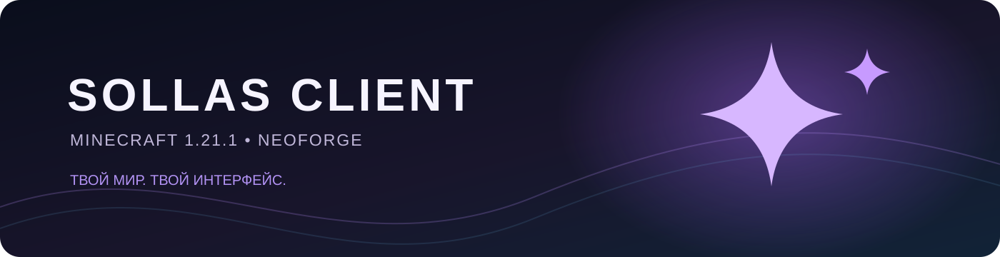
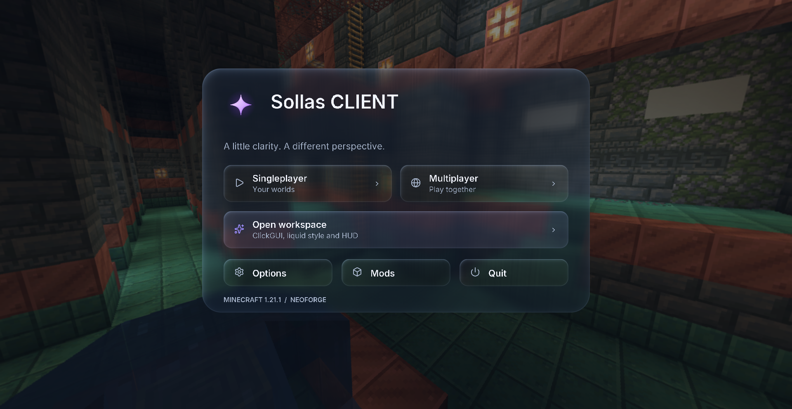
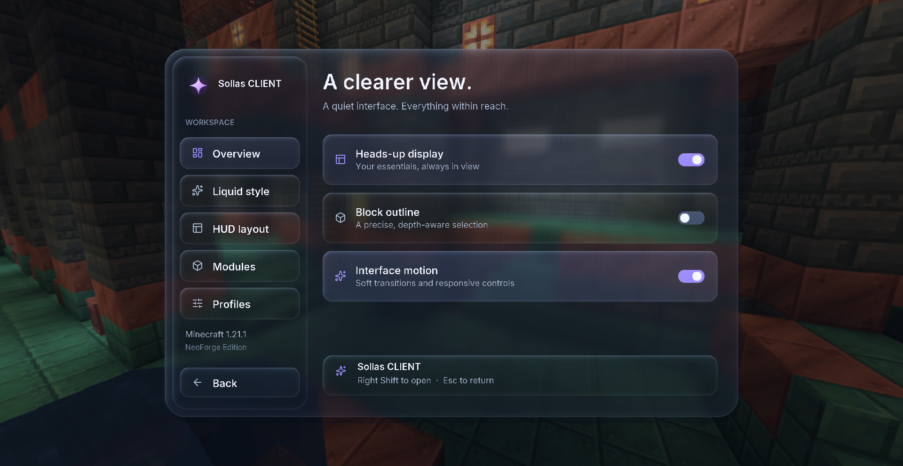
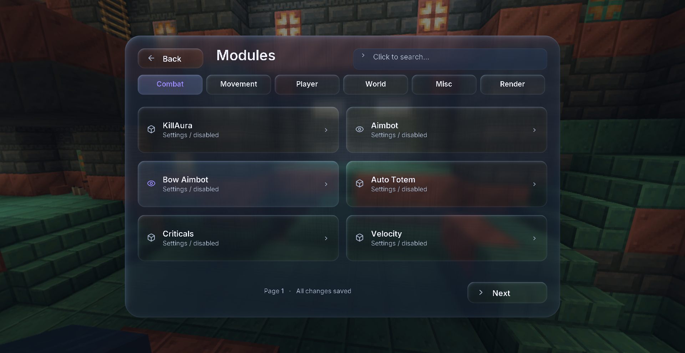

<p align="center">
  
</p>

<p align="center"><strong>Клиентский мод для Minecraft с настраиваемым интерфейсом, визуальными эффектами и модулями.</strong></p>
<p align="center">Minecraft Java 1.21.1 · NeoForge 21.1.265 · Java 21</p>
<p align="center"><a href="https://github.com/Leshechkawww/Sollas-CLIENT/releases/latest"><strong>Скачать последнюю версию</strong></a> · <a href="#установка">Установка</a> · <a href="#для-разработчиков">Разработка</a></p>

---

## Знакомься: Sollas CLIENT

Sollas CLIENT объединяет интерфейс в стиле liquid glass, настраиваемый HUD и набор модулей для игры. Цвета, отображаемые элементы и параметры многих функций можно подстроить под себя.

<p align="center"><br><sub>Главное меню Sollas CLIENT</sub></p>

## Интерфейс и HUD

- **Liquid glass** — полупрозрачные панели и анимации в меню, настройках и инвентаре.
- **Настраиваемый HUD** — FPS, скорость в блоках в секунду, имя игрока, время и координаты. Элементы и цвет можно настроить.
- **Рабочее пространство** — настройки внешнего вида, HUD, модулей и профилей в одном месте.
- **Target HUD** — карточка игрока под прицелом с информацией о цели и настройками отображения.

<p align="center"><br><sub>Рабочее пространство с настройками интерфейса</sub></p>

## Модули

Модули разделены на **Combat, Movement, Player, World, Misc и Render**. В интерфейсе есть поиск, настройки и привязка клавиш.

| Раздел | Примеры возможностей |
| --- | --- |
| Интерфейс | Crosshair, HP Indication, Target HUD, прозрачный инвентарь |
| Визуальные эффекты | Trails с выбором цвета, Block Outline, Full Bright, Entity ESP, Custom World |
| Камера и предметы | Freelook, FreeCam, View Model, анимации оружия |
| Игровые модули | Auto Sprint, Auto Armor, Scaffold и другие модули движения и боя |
| Тестирование | Fake Player — локальная цель для настройки и проверки эффектов |

<p align="center"><br><sub>Категории, поиск и настройки модулей</sub></p>

> Доступность и поведение отдельных функций могут зависеть от версии игры, других модов и настроек сервера. Используй клиент с учётом правил сервера.

## Установка

1. Установи **Minecraft Java 1.21.1** и **NeoForge 21.1.265**.
2. Открой [последний релиз](https://github.com/Leshechkawww/Sollas-CLIENT/releases/latest) и скачай файл `Sollas-CLIENT-1.0.0.jar` из раздела **Assets**.
3. Положи JAR в папку `mods` нужного профиля Minecraft.
4. Запусти профиль NeoForge. Для открытия рабочего пространства нажми **Right Shift** или выбери **Open workspace** в главном меню.

Репозиторий сейчас приватный — для скачивания другу понадобится приглашение и доступ к нему на GitHub.

## Ошибки и идеи

Нашёл ошибку или придумал улучшение? [Создай задачу на GitHub](https://github.com/Leshechkawww/Sollas-CLIENT/issues/new/choose) и выбери подходящую форму. История версий находится в [CHANGELOG.md](CHANGELOG.md). Проверку сборки и её JAR можно найти во вкладке [Actions](https://github.com/Leshechkawww/Sollas-CLIENT/actions).

## Для разработчиков

Нужны **JDK 21**, доступ в интернет для первой загрузки зависимостей и среда разработки с поддержкой Gradle. Открой проект в IntelliJ IDEA или другом редакторе.

```powershell
# Windows: сборка
.\gradlew.bat build

# Запуск клиента для разработки
.\gradlew.bat runClient
```

В Linux и macOS используй `./gradlew build` и `./gradlew runClient` (при необходимости сначала `chmod +x gradlew`). Результат сборки находится в `build/libs/`. Исходники и ресурсы — в `src/`; локальные миры и настройки игры в репозиторий не входят.

Внутренний идентификатор мода пока — `examplemod`. Его переименование требует согласованного изменения кода и ресурсов.

## Участники и лицензия

- **Leshechkawww** — владелец и автор проекта.
- **Codex (OpenAI)** — AI-помощник по разработке.

Права на проект: **All Rights Reserved**. Лицензии сторонних ресурсов находятся в [`src/main/resources/licenses/`](src/main/resources/licenses/).
